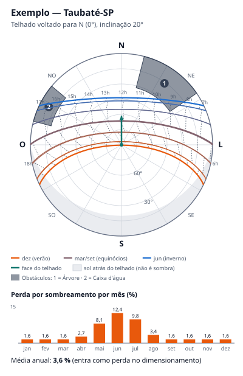

**LUMINI** — **AVALIAÇÃO DA VISUALIZAÇÃO DO SOMBREAMENTO (SCRUM-81): 2D SIMPLIFICADO × 3D COMPLETO**

Versão 1.0 — 23 de setembro de 2026

# 1. Pergunta

O SCRUM-81 pede para *"avaliar se um gráfico 2D simplificado já comunica o mesmo valor que uma renderização 3D completa, com bem menos esforço de engenharia"*, antes de renderizar o sombreamento sobre o telhado medido (RF06).

# 2. O que a visualização precisa comunicar

A visualização serve ao técnico, no app (RF06, passo 4), e ao gestor, no detalhe da proposta na web (RF23). Nos dois casos, ela precisa responder a três perguntas:

1. **Quando** o telhado fica sombreado (meses e horários) e **por qual obstáculo**.
2. **Quanto** isso pesa: o percentual mensal e o anual, que entra como perda no dimensionamento (RF06, passo 5).
3. Se a **orientação e a inclinação** do telhado são boas (quando o sol fica atrás do plano dos módulos).

# 3. Opções avaliadas

- **A — Diagrama solar 2D (polar) + barras mensais.** Visão do céu a partir do telhado: trajetória do sol no dia 21 de cada mês, obstáculos como faixas a partir do horizonte, linhas de hora, região "atrás do telhado" e barras com a perda de cada mês.
- **B — Cena 3D com sombras dinâmicas** (ViroReact): o telhado e os obstáculos modelados em 3D, com uma luz direcional que acompanha a data e a hora e projeta as sombras.

| Critério | A — 2D | B — 3D |
|---|---|---|
| Responde às 3 perguntas | Sim, no mesmo quadro: o ano inteiro, as horas, os obstáculos e os percentuais | Parcialmente: mostra a sombra de **um instante**; para ver o ano é preciso animar ou percorrer datas, e o percentual continua vindo do cálculo |
| Funciona no Modo Leve (RF05/RF19) | Sim: precisa só de coordenadas, orientação, inclinação e obstáculos | Não: depende de ARKit/ARCore e da cena |
| Mesma visualização na web (RF23, D06) | Sim: o mesmo SVG é exibido no detalhe da proposta | Não: a web precisaria de outro motor 3D e dos dados da malha |
| Desempenho em aparelho de entrada (RNF01) | Cálculo do ano inteiro + SVG em ~15 ms no computador de desenvolvimento | Renderização contínua com sombras dinâmicas exige GPU e bateria |
| Esforço | Implementado neste item (13 SP no backlog) | Estimativa de 21 a 34 SP adicionais, concorrendo com a RA obrigatória na Sprint Interna 5 |
| Testabilidade | Saída determinística, coberta por testes automatizados | Validação visual manual em dispositivo |
| Familiaridade | É o formato dos instrumentos de levantamento de sombra (ex.: Solar Pathfinder e SunEye mostram a trajetória do sol sobre o perfil do horizonte) | Mais impressionante em demonstração, mas sem ganho de informação |

# 4. Decisão

**Opção A (2D) no MVP**, em linha com a *Documentação das Stacks Mobile* v1.1 ("a visualização do sombreamento no MVP é 2D"). O 3D não comunica mais do que o diagrama e custaria mais do que o esforço de todo o SCRUM-81, justamente na sprint mais carregada do cronograma.

O papel da Realidade Aumentada no sombreamento continua sendo **marcar os obstáculos** na cena (RF04, passo 5): o app converte cada obstáculo em perfil angular (azimute inicial/final e altura angular) e gera o mesmo diagrama 2D. Uma sombra 3D dentro da cena de RA fica como melhoria futura, se sobrar tempo depois da RA obrigatória.

# 5. Exemplo

Cenário fictício em Taubaté-SP: telhado voltado para o Norte com 20° de inclinação, uma árvore a Nordeste (8 m de distância, 5 m acima do telhado) e uma caixa d'água a Oeste-Noroeste.

Como ler:

- **Centro** = sol a pino; **borda** = horizonte; Norte para cima e Leste à direita.
- **Curvas** = trajetória do sol no dia 21 de cada mês (laranja = verão, azul = inverno). As linhas tracejadas ligam a mesma hora em meses diferentes.
- **Faixas escuras numeradas** = obstáculos. Onde uma curva atravessa uma faixa, o telhado fica sombreado naquela época e hora — no exemplo, a árvore sombreia as manhãs de maio a agosto.
- **Área cinza-clara** = sol atrás do plano do telhado (efeito da orientação, não de sombra).
- **Barras** = perda por sombreamento em cada mês; a média anual (3,6 % no exemplo) vai para o dimensionamento.

O exemplo é gerado por `npm run exemplo-sombreamento -w @lumini/domain`.

# 6. Modelo de cálculo e limitações

O cálculo está em `packages/domain/src/sombreamento/sombreamento.ts`:

- trajetória solar pelo algoritmo do NOAA (SCRUM-80), no dia médio de Klein de cada mês, em passos de 10 min;
- irradiância direta de céu claro (Meinel, massa de ar de Kasten & Young) projetada no plano do telhado;
- sombreamento direto = energia direta bloqueada pelos obstáculos ÷ energia direta no plano;
- parcela difusa bloqueada estimada pelo perfil do horizonte (céu isotrópico);
- perda do mês = 0,6 × direta + 0,4 × difusa (fração direta configurável); média anual ponderada pela energia de cada mês.

Limitações conhecidas, aceitáveis no MVP:

- os obstáculos são vistos do **centro** do telhado: uma sombra que atinge só parte dos módulos é tratada como se atingisse todos;
- não modela o efeito elétrico da sombra parcial em uma string (*mismatch*);
- usa céu claro: em meses nublados a sombra direta pesa menos do que o calculado (estimativa conservadora).

# 7. Integração

- **App:** `gerarDiagramaSombreamento(...)` devolve o SVG e os números; a tela exibe com `<SvgXml xml={svg} width="100%" />` (react-native-svg).
- **Web:** o mesmo SVG no detalhe da proposta (RF23), regenerado a partir dos dados sincronizados.
- **Banco (Simulação de Sombreamento):** `sombreamento_perc` = `mediaAnualPerc`; `sombreamento_mensal` = `mensal[].sombreamentoPerc`; `obstaculos` = lista de obstáculos angulares; `origem` = "Sun path + RA" ou "Sun path manual".
